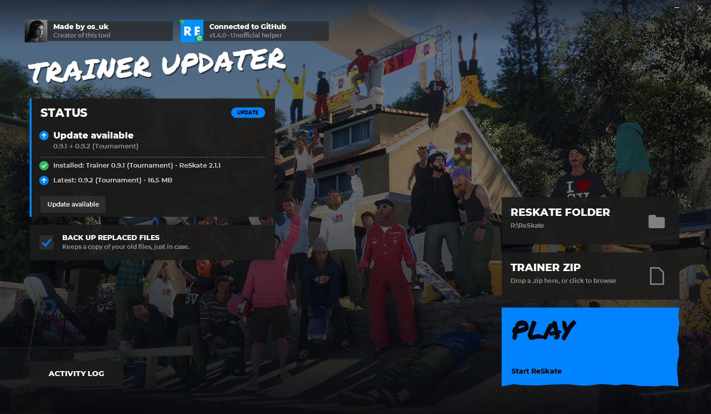
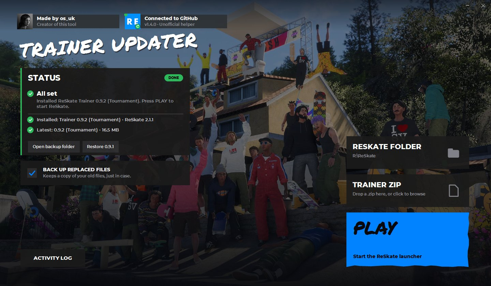

# ReSkate Trainer Updater

[](../../actions/workflows/ci.yml)

A small Windows app that installs the newest [ReSkate Trainer](https://github.com/andrewnakas/reskate-trainer) into your ReSkate folder. It finds your ReSkate folder, shows what's new, installs the update with one click, and then starts the game for you. If you already have a Trainer zip, you can drop it on the window instead.





This is an unofficial helper. It isn't made by, or affiliated with, the ReSkate or ReSkate Trainer authors.

## Using it

1. Download `ReSkateTrainerUpdater-Setup-<version>.exe` from the [latest release](../../releases/latest) and run it. It installs the updater for you only (no administrator needed), adds it to your Start Menu, and lists it under Settings, Apps, where you can uninstall it. Prefer no installer? The `.zip` on the same page is the portable exe: unzip it anywhere you can write to. If Windows shows a blue "Windows protected your PC" screen, see [below](#if-windows-says-windows-protected-your-pc).
2. Open the updater. The first time, it looks in the usual places for your ReSkate folder and offers the one it finds: click **USE IT**. If it doesn't find it, click the folder box and choose the folder with `ReSkateLauncher.exe`. The app remembers it for next time.
3. Click the big blue tile. It says **UPDATE** when a newer Trainer is published, **INSTALL** for an empty folder, **ADD TRAINER** if you have plain ReSkate, or **SWITCH** if you have another edition and want to move to Tournament (it asks first). When you're current, the status card says so and the tile is **PLAY**.
4. If the game or its launcher is open, the tile becomes **CLOSE GAME**. It tells you which program is in the way and, only if you say yes, closes it and carries on with the install.
5. Click **PLAY** to start the ReSkate launcher.

**Going back.** Each update keeps a copy of the files it replaced (the newest three are kept, older ones are deleted for you). After an update, **Restore 0.9.1** (or whichever version you had) puts them back. Your newer files are saved first, so you can switch back again. **Open backup folder** shows you the copies.

**The updater updates itself.** When a new version of this app is published, the big tile says **UPDATE APP** and shows how big the download is. One click downloads it, checks it, swaps it in and restarts. You only ever download or install the app once. If it says it can't replace itself, the portable exe is in a folder you can't write to (such as `Program Files`): move it to your Desktop or another folder you own, or use the setup, which installs somewhere that always works.

**Offline, or a different version:** drop a ReSkate Trainer zip onto the window (or click the zip tile to browse), then click the **INSTALL** tile. A zip inside a zip, or one wrapped in a folder, is fine.

**Can't reach GitHub?** The status card says so, calmly, and offers **Check again**. Clicking the GitHub chip at the top checks again too.

**Something went wrong?** Open **ACTIVITY LOG**, press **COPY LOG**, then **REPORT A PROBLEM**. It opens a GitHub issue with your app and Windows version already filled in. Paste the log into it. Nothing is sent until you submit it yourself.

### If Windows says "Windows protected your PC"

The setup and the exe aren't code-signed, because a signing certificate costs money and this is a free community tool. So Windows SmartScreen shows a blue "Windows protected your PC" screen the first time you run a new download. That's expected:

1. Click **More info** (the small link in the blue window).
2. A **Run anyway** button appears. Click it.

Every download's SHA-256 is checked by the app itself before anything is installed, and all the source is in this repository to read.

## What it checks

**Downloads**
- It only downloads Trainer zips from this repository's GitHub Releases.
- The size and SHA-256 of every download must match the published [`latest.json`](latest.json) exactly, or the file is deleted and nothing is installed.
- The version, edition and build inside the downloaded DLL must match what was published.

**The zip**
- It contains `ReSkate.dll` and `ReSkateLauncher.exe`, both real 64-bit Windows programs that identify as ReSkate.
- It reads the Trainer version out of the DLL (for example `0.9.2`, Tournament edition, built on ReSkate 2.1.1).
- It warns if the two files don't match each other, or if the zip has no Trainer in it.

**Your ReSkate folder**
- It shows which Trainer version is installed there now and compares it with the zip: update, already up to date, different build, or downgrade (it asks first).
- It refuses Steam's own `skate.` folder, because the launcher can't run from there, and warns about special characters in the path.

**While installing**
- Before changing anything it checks that no file is in use or protected, so an open game leaves your files untouched.
- Every replaced file is copied to `_ReSkateTrainerUpdater_backup_<date>` inside your folder, and the newest three backups are kept. You can switch this off.
- If something fails part-way, your original files are put back, so you never end up half-updated.
- It only closes the game or launcher if you press **CLOSE GAME** and answer yes.

## Privacy

The app contacts GitHub only, and only when something asks it to:

- **On start-up**, and again only if you press **Check again** or click the GitHub chip, it downloads [`latest.json`](latest.json) from this repository to see whether a newer Trainer is published. It never checks on a timer.
- **When you click the big tile** it downloads one zip from this repository's Releases: a Trainer, or a new version of this app.

On the first run it also looks through a few folders on your PC (Desktop, Documents, Downloads and the like) for `ReSkateLauncher.exe`, to suggest your ReSkate folder. That search stays on your PC and nothing about it is sent anywhere.

**Release notes** and **Report a problem** just open GitHub in your browser, like any link. The app sends nothing: you read the page, and you submit an issue yourself if you want to.

It sends nothing about you, your PC or your game: no IDs, folder paths, versions or usage data. GitHub sees your IP address, as with any visit to github.com. It never installs anything, and never closes a program, without your click. If you're offline, it skips the check silently and the drop zone works as before.

## Credits and licences

This updater was made by **os_uk**.

The ReSkate Trainer is GPL-3.0 software by its authors. The Trainer zips published here are redistributed unmodified, with their `LICENSE.txt` and `README.txt` included. Source code:

- ReSkate: https://github.com/Dingo-Shenanigans/ReSkate
- ReSkate Trainer: https://github.com/andrewnakas/reskate-trainer
- Dark Pop: https://github.com/Sivaes/darkpop
- Grab Fix: https://github.com/Sivaes/grabbugs

The window is styled after the ReSkate launcher and uses the same free fonts, Montserrat and Permanent Marker. Their licences are in [THIRD-PARTY-NOTICES.md](THIRD-PARTY-NOTICES.md), which is also inside every release zip.

## Building from source

You need Windows 10/11 and the [.NET 8 SDK](https://dotnet.microsoft.com/download/dotnet/8.0).

```
dotnet build
dotnet run --project src/ReSkateTrainerUpdater
```

Run the tests (they run on any OS, no packages needed):

```
dotnet run --project tests/ReSkateTrainerUpdater.Tests
```

Build the single-file exe and zip it for sharing:

```
powershell -ExecutionPolicy Bypass -File .\scripts\build-release.ps1
```

The exe is self-contained, so players don't need to install .NET. The result is in `release/`.

**Maintainers:** releasing the app and publishing a new Trainer zip are described step by step in [docs/RELEASING.md](docs/RELEASING.md). AI coding agents should read [CLAUDE.md](CLAUDE.md) first.

## Project layout

| Path | What it holds |
|---|---|
| `src/ReSkateTrainerUpdater.Core` | All the logic, with no UI: reading versions, checking zips and folders, online updates, installing, the status messages |
| `src/ReSkateTrainerUpdater` | The WinForms app: the window and its custom dark controls |
| `tests/ReSkateTrainerUpdater.Tests` | Tests for the Core library, using small generated stand-ins for the ReSkate files and a fake GitHub |
| `tools/ReSkateTrainerUpdater.ManifestTool` | The maintainer's tool that writes and verifies `latest.json` |
| `latest.json` | The newest published Trainer for each edition, read by the app on start-up |
| `docs` | Architecture, the online update format, and the release steps |
| `THIRD-PARTY-NOTICES.md` | Licences for the embedded fonts |
| `scripts` | `build-release.ps1` |

## Notes

- If a future Trainer build stores its version differently, the app still installs it from a dropped zip but says it couldn't read the version.
- Settings (last folder, backup switch, where the window was) are stored in `%AppData%\ReSkateTrainerUpdater\settings.json`.
- The window has a fixed size, like the ReSkate launcher's, so it stays in proportion. It does remember where you last left it.
- The screenshots above show the ReSkate launcher's background picture, which is game artwork that belongs to Electronic Arts and Full Circle. See [THIRD-PARTY-NOTICES.md](THIRD-PARTY-NOTICES.md).
